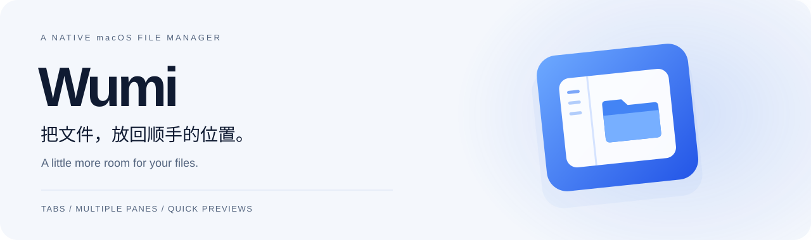
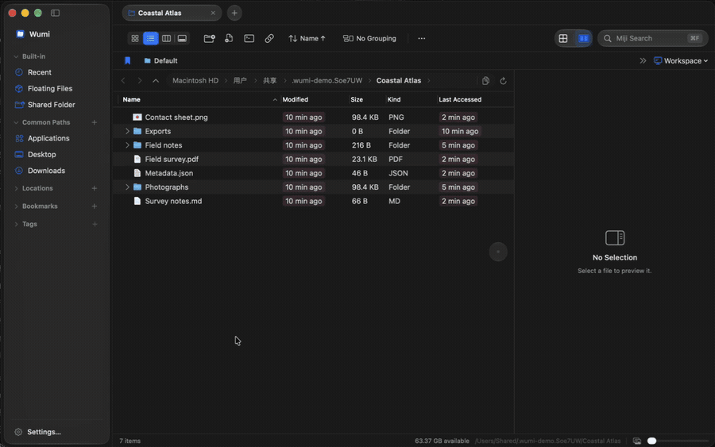

<picture>
  <source media="(prefers-color-scheme: dark)" srcset="docs/assets/hero-dark.svg">
  
</picture>

<p align="center">
  <a href="https://github.com/kbwumin13-sudo/Wumi/releases/download/v1.3.0/Wumi-1.3.0-arm64.dmg"><strong>下载 Wumi 1.3.0</strong></a> ·
  <a href="#上手">安装</a> ·
  <a href="https://github.com/kbwumin13-sudo/Wumi/releases/latest">最新版本</a> ·
  <a href="https://github.com/kbwumin13-sudo/Wumi/issues">反馈</a>
</p>

Wumi 是一款用 Swift、AppKit 和 SwiftUI 构建的原生 macOS 文件管理器。在同一个工作区里并排浏览目录、预览文件、用觅迹找回内容，再把准备处理的文件放进中转站。

## 看看新版工作区

<p align="center">
  <a href="https://github.com/kbwumin13-sudo/Wumi/releases/download/v1.3.0/Wumi-1.3.0-demo.mp4"></a>
</p>

<p align="center"><sub>正式版实录，使用合成文件。<a href="https://github.com/kbwumin13-sudo/Wumi/releases/download/v1.3.0/Wumi-1.3.0-demo.mp4">观看清晰版 MP4</a></sub></p>

标签页、工具栏、路径栏和浮动文件采用统一的外观。展开文件夹、切换检查器和打开预览时，动效会跟随当前操作。支持 Liquid Glass 的 macOS 使用系统玻璃材质，同时尊重系统的减少动态效果与降低透明度设置。

## 从浏览到找到文件

| 操作 | Wumi 提供的入口 |
| --- | --- |
| 并排浏览几个目录 | 多标签、多窗格、四种浏览视图，可保存和恢复工作区 |
| 打开前看一眼 | 检查器、Quick Look 和超级预览，可查看 PDF、图片、视频和文本 |
| 暂放准备处理的文件 | 从侧栏或菜单栏打开浮动文件，把文件放进中转站，再到目标目录取用 |
| 批量整理 | 重命名、压缩解压、校验和、PDF 工具、文件夹同步与可撤销的常用文件操作 |

内置 **觅迹 1.4.0** 延续独立版的浮窗设计和三种浏览入口。按 **⌃⌥Space** 打开，按 **⌘1** 浏览应用、**⌘2** 浏览最近文件、**⌘3** 打开剪贴板，**⌘0** 回到全部搜索。文件名、拼音、正文和图片里的文字都可以作为搜索线索。剪贴板记录由用户开启，随应用会话结束而清除。

觅迹使用 Wumi 已有的本地索引。Wumi 的高级布尔搜索可从觅迹浮窗的菜单进入。

## 上手

[下载 Wumi-1.3.0-arm64.dmg](https://github.com/kbwumin13-sudo/Wumi/releases/download/v1.3.0/Wumi-1.3.0-arm64.dmg)，适用于 **macOS 15 或更新版本及 Apple Silicon**。

1. 打开 DMG，将 Wumi 拖到「应用程序」。
2. 从「应用程序」打开 Wumi。首次若被 Gatekeeper 拦截，可在「系统设置 → 隐私与安全性」里选择「仍要打开」。
3. 按需要在 Wumi 的「设置 → 隐私与权限」授权受保护目录。

下载包使用 ad-hoc 签名，未经 Apple 公证。校验文件与安装包一并提供。验证范围、改动和校验命令见 [1.3.0 发布说明](docs/releases/v1.3.0.md)。

<details>
<summary><strong>构建与开发</strong></summary>

使用 Swift 6.2+ 和包含对应 macOS SDK 的 Xcode 工具链。

```sh
git clone https://github.com/kbwumin13-sudo/Wumi.git
cd Wumi
scripts/build-app.sh
open build/Wumi.app
```

可通过 [构建与运行](docs/构建与运行.md) 查看签名、本地数据、调试和测试说明。

</details>

## 许可

Wumi 使用 [MIT License](LICENSE)。文件索引和搜索界面复用 [觅迹](https://github.com/kbwumin13-sudo/miji) 的实现，许可与来源见 [第三方许可](THIRD_PARTY_NOTICES.md) 和 [内置觅迹同步记录](Vendor/Miji/UPSTREAM.md)。
