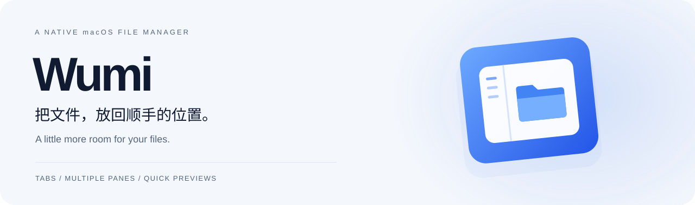
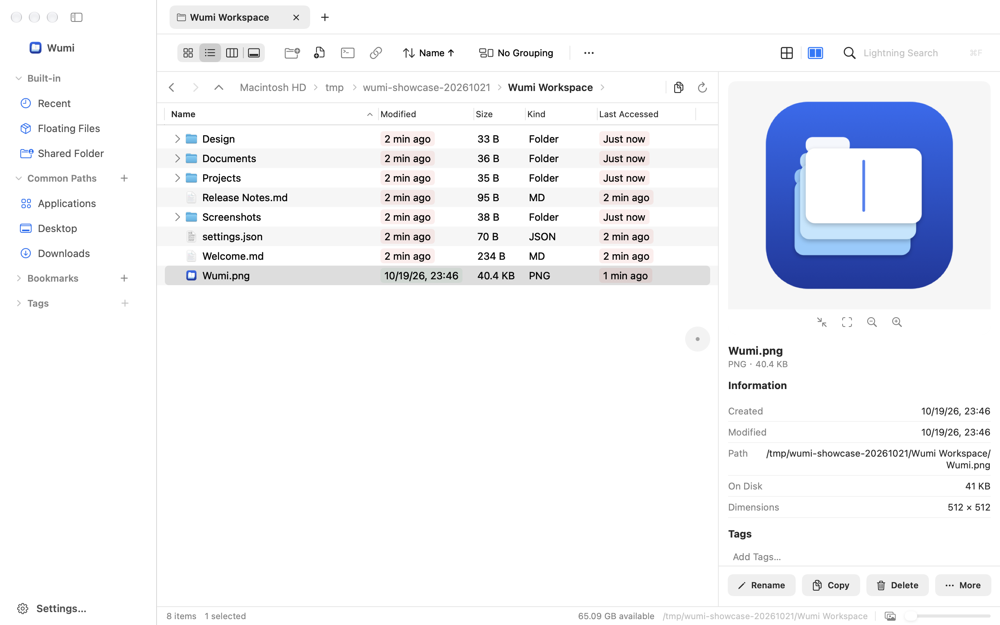

<picture>
  <source media="(prefers-color-scheme: dark)" srcset="docs/assets/hero-dark.svg">
  
</picture>

<div align="center">

[](#上手)
[](Package.swift)
[](https://github.com/kbwumin13-sudo/Wumi/releases/download/v1.2.6/Wumi-1.2.6-arm64.dmg)
[](LICENSE)

**原生 macOS 文件管理器 · 多标签、多窗格、即时预览与闪电搜索**

[下载 1.2.6 DMG](https://github.com/kbwumin13-sudo/Wumi/releases/download/v1.2.6/Wumi-1.2.6-arm64.dmg) · [最新 Release](https://github.com/kbwumin13-sudo/Wumi/releases/latest) · [安装](#上手) · [功能](#少切换几个窗口多留一点专注) · [开发文档](docs/构建与运行.md) · [反馈](https://github.com/kbwumin13-sudo/Wumi/issues)

</div>

把项目并排打开，把常用位置留在手边，在打开文件之前先看一眼。Wumi 将日常浏览、整理、预览和搜索放进一个遵循 macOS 使用习惯的工作区，以 Swift、AppKit 和 SwiftUI 构建。

<picture>
  <source media="(prefers-color-scheme: dark)" srcset="docs/assets/workspace-dark.png">
  
</picture>

<p align="center"><sub>Wumi 1.1.1 原生窗口渲染，使用独立演示目录。主视觉和截图随 GitHub 深浅色主题切换。</sub></p>

## 少切换几个窗口，多留一点专注

| 浏览与组织 | 预览与操作 |
| :--- | :--- |
| **多标签、多窗格** — 并排处理目录，保存工作区，恢复上次会话。 | **先看再打开** — 列表、图标、分栏、画廊四种视图，搭配检查器、Quick Look 与超级预览。 |
| **闪电搜索** — 本地文件名索引、查询过滤与内容搜索，支持后台增量更新。 | **整理更顺手** — 批量重命名、压缩与解压、校验和、文件夹同步，以及可撤销的常用文件操作。 |
| **目录状态一眼可见** — 文件夹与应用包大小、排序分组、Git 状态和 iCloud 传输徽标。 | **常用工具就在旁边** — PDF 拆分合并、图片转换处理、新建文档模板和终端入口。 |
| **常用位置不用反复找** — 书签、标签、常用路径和文件暂存浮窗。 | **融入系统** — 原生菜单与快捷键、深浅色外观，提供中文、英文等 10 种界面语言。 |

## 上手

下载 [Wumi-1.2.6-arm64.dmg](https://github.com/kbwumin13-sudo/Wumi/releases/download/v1.2.6/Wumi-1.2.6-arm64.dmg)，适用于 **macOS 15+、Apple Silicon（arm64）**。本轮内置觅迹同步至 1.3，改进正文候选与排序、旧结果动作门禁和搜索状态呈现，保留已有索引与配置。详见 [1.2.6 改动与验证范围](docs/releases/v1.2.6.md)。后续版本可从 [最新 Release](https://github.com/kbwumin13-sudo/Wumi/releases/latest) 选择资产。

1. 打开 DMG，将 `Wumi.app` 拖到 `Applications`（应用程序）文件夹。
2. 从「应用程序」打开 Wumi。
3. 首次若被 Gatekeeper 拦截，在「系统设置 → 隐私与安全性」中找到此次拦截的提示，选择「仍要打开」，再按系统提示确认。

此安装包仅使用 **ad-hoc 签名**，没有 Developer ID 签名，也未经 Apple 公证。首次访问受保护目录时，按系统提示或应用「设置 → 隐私与权限」授权。

[1.2.6 发布说明与 SHA-256 校验方法](docs/releases/v1.2.6.md) · [安装与开发说明](docs/构建与运行.md)

<details>
<summary><strong>从源码构建</strong></summary>

需要 Swift tools 6.2+ 及包含对应 macOS SDK 的 Xcode 工具链；既有本地验证环境为 Apple Silicon、Swift 6.4。

```sh
git clone https://github.com/kbwumin13-sudo/Wumi.git
cd Wumi
scripts/build-app.sh
open build/Wumi.app
```

默认构建 Release 版本。脚本优先使用已有的本地自签名证书 `DirDesk Local Signing`，找不到时使用 ad-hoc 签名；需要在反复本机构建后保留隐私授权，可选择运行 `scripts/make-signing-cert.sh` 创建本地证书。本地证书与公开 DMG 的签名方式不同。

更完整的签名、测试、截图与本地化说明见 [构建与运行](docs/构建与运行.md)。

</details>

## 验证与边界

既有验收记录（2026-10-21）：**205 项 Core 测试，0 失败，4 项条件跳过**，匿名化会话夹具后的解码回归通过；1.1.1 的历史窗口验收覆盖了 **65 项应用内回归**，包含文件操作、撤销、导航、排序、会话与文件夹大小。iCloud 上传、下载与云端文件打开曾在真实账号下验证。本次 DMG 另经干净源码 Release 重新构建、完整性校验、只读挂载检查，并从安装包复制出的隔离副本通过了 65 项窗口内回归；实际从互联网下载后首次 Gatekeeper 授权流程未在另一台 Mac 验证。

- 历史 Core 测试的四项条件跳过涉及真实 iCloud、十万项目录、全盘爬取与百万条索引。尚未逐项完成所有设置和交互的窗口验收。
- 文件夹大小在后台统计；计算中显示进度，无权限项目显示不可用或已知下界。实际结果受目录权限与文件变化影响。
- 超大目录和「所有子文件」目前最多一次载入 10 万项。索引存在容量与资源限制，不能将已有索引等同于全盘覆盖。
- 此次 DMG 仅提供 arm64，不提供 Intel 安装包；仅 ad-hoc 签名，没有 Developer ID 签名或 Apple 公证。长期含索引的资源占用仍待验证。Pages、Keynote、Numbers 新建模板暂受限。

<details>
<summary><strong>工程结构与开发入口</strong></summary>

```text
Sources/
  DirDesk/          AppKit + SwiftUI 应用、文件视图与检查器
  DirDeskCore/      文件操作、索引、归档、同步与工具
  CArchive/         macOS 系统 libarchive 的 C 接口声明
Resources/          Info.plist 与十语言字符串
Tests/              Core 回归测试与匿名化夹具
scripts/            构建、图标、本地化与性能测量
docs/               开发说明、设计与产品截图
```

```sh
swift test
python3 -I scripts/l10n/check_translations.py .
scripts/build-app.sh debug
```

内部模块与可执行文件保留 `DirDesk` 名称，Bundle ID 为 `com.kbwumin13.dirdesk`，以兼容已有偏好、会话与索引。

[实现说明](docs/实现说明.md) · [设计规范](DESIGN.md) · [性能测量方法](scripts/performance/README.md)

</details>

## 致谢与许可

Wumi 以 [MIT License](LICENSE) 发布。文件索引工作参考与复用了 [觅迹](https://github.com/kbwumin13-sudo/miji) 的实现经验，上游沿革及系统 libarchive 等说明见 [第三方许可](THIRD_PARTY_NOTICES.md)。

功能最初参考 DirDeck 1.7，Wumi 是独立实现，与其没有隶属关系；应用图标与长段文案自行创作。当前视觉按 Wumi 的设计规范独立演进。
